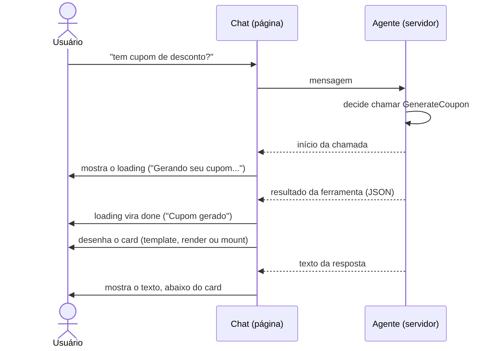
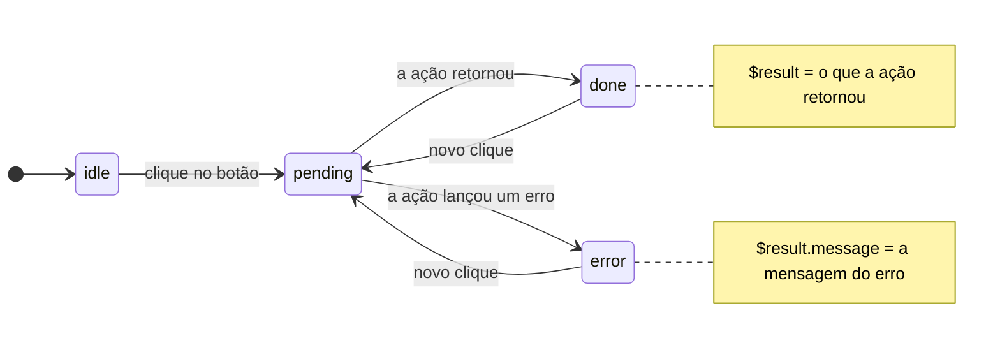

# Ferramentas do agente (`backendTools`)

Durante uma resposta, o agente pode chamar **ferramentas** que rodam no servidor, por exemplo para gerar um cupom ou buscar nos documentos do produto. Por padrão, o usuário só lê o texto que o agente escreve sobre o resultado. A opção `backendTools` deixa a página decidir **como cada ferramenta aparece no chat**: um texto de carregamento enquanto ela roda e, quando termina, um card com o resultado e botões que chamam funções da própria página.

> O nome `backendTools` indica que essas ferramentas **são executadas no servidor**. A página só define a aparência e o que os botões fazem. Ferramentas executadas pela própria página terão uma opção própria no futuro.

## Sumário

1. [Como funciona](#como-funciona)
2. [Configuração mínima: texto de carregamento](#configuracao-minima)
3. [Mostrando o resultado](#mostrando-o-resultado)
   - [Template HTML](#template)
   - [Botões e ações](#acoes)
   - [`render`: elemento ou HTML próprio](#render)
   - [`mount`: componentes React, Vue, Angular…](#mount)
4. [O objeto `ctx`](#ctx)
5. [Casos de uso completos](#casos-de-uso)
6. [Comportamentos e casos de borda](#casos-de-borda)
7. [Referência das opções](#referencia)

---

<a id="como-funciona"></a>
## 1. Como funciona



- A chave de `backendTools` é o **nome da ferramenta no servidor**, exatamente como o agente a declara (ex.: `GenerateCoupon`).
- **Uma ferramenta que não está em `backendTools` não aparece no chat.** O usuário só lê o que o agente escreve.
- O **resultado** recebido pelas funções e pelo template é o JSON que a ferramenta retornou no servidor, já convertido em objeto.

---

<a id="configuracao-minima"></a>
## 2. Configuração mínima: texto de carregamento

Para ferramentas que não precisam de card, como uma busca, basta mostrar o que está acontecendo:

```js
tutorChat.options = {
  // ...demais opções
  backendTools: {
    SearchOrders: {
      loading: 'Consultando seus pedidos...',   // aparece com efeito de brilho enquanto roda
      done: 'Pedidos consultados',              // substitui o loading quando termina
      error: 'Não foi possível consultar',      // substitui o loading se a ferramenta falhar
    },
  },
};
```

| Opção | Quando aparece |
|---|---|
| `loading` | assim que a ferramenta começa |
| `done` | no lugar de `loading`, quando o resultado chega |
| `error` | no lugar de `loading`, se a ferramenta falhar ou o resultado for inválido. Sem `error`, usa `done`, e sem `done`, o próprio `loading` (sem o brilho) |

> **Padrão:** a busca nos documentos do tutor (`OpenSearch`) já vem configurada com "Buscando nos documentos..." / "Buscou documentos". Para trocar os textos, configure `OpenSearch` em `backendTools`.

---

<a id="mostrando-o-resultado"></a>
## 3. Mostrando o resultado

Existem três formas de desenhar o resultado. Use **uma** por ferramenta. Se mais de uma for informada, vale a primeira desta ordem: **`mount` → `render` → `template`**.

| Forma | Quando usar |
|---|---|
| `template` | HTML simples com os dados do resultado e botões. Não exige JavaScript para o desenho. |
| `render` | Você já tem um elemento pronto (um web component, por exemplo) ou quer montar o HTML em código. |
| `mount` | O card é um componente do seu framework (React, Vue, Angular, Solid…). |

<a id="template"></a>
### 3.1 Template HTML

Um HTML com marcações `{{campo}}` que o chat preenche com o resultado da ferramenta:

```js
backendTools: {
  GenerateCoupon: {
    loading: 'Gerando seu cupom...',
    done: 'Cupom gerado',
    template: `
      <style>
        .cupom { display: flex; gap: 12px; padding: 12px; border-radius: 12px; background: #effaf6; }
        .cupom .pct { font-size: 28px; font-weight: 800; color: #0e7c66; }
        .cupom .code { font-family: monospace; font-weight: 700; }
      </style>
      <div class="cupom">
        <span class="pct">{{discountPercent}}%</span>
        <div>
          <div>{{productName}}</div>
          <div class="code">{{code}}</div>
        </div>
      </div>`,
  },
},
```

Com o resultado `{ "code": "IZY0443A1", "discountPercent": 10, "productName": "Aprendendo Tênis" }`, o card mostra `10%`, `Aprendendo Tênis` e `IZY0443A1`.

**Regras das marcações:**

| Marcação | Resultado |
|---|---|
| `{{code}}` | o valor de `code` no resultado |
| `{{customer.name}}` | caminho com ponto: `customer.name` |
| `{{Code}}` ou `{{code}}` | funcionam igual. A primeira letra pode estar em maiúscula ou minúscula, porque servidores .NET às vezes serializam em PascalCase |
| campo inexistente ou `null` | vazio |
| `{{$state}}` | estado da última ação do card: `idle`, `pending`, `done` ou `error` ([veja ações](#acoes)) |
| `{{$result.message}}` | o que a última ação retornou ([veja ações](#acoes)) |

**Segurança:** todo valor é **escapado** antes de entrar no HTML. Um resultado com `<script>` ou `` aparece como texto, sem executar. O template em si é seu e é inserido como está.

**Estilos:** o card fica dentro do Shadow DOM do chat, então **o CSS da página não chega até ele**. Coloque os estilos em uma tag `<style>` dentro do próprio template, como no exemplo. Para não afetar o resto do chat, use classes com nomes próprios (`.cupom`, e não `.card` ou `button`).

<a id="acoes"></a>
### 3.2 Botões e ações

Um botão no template indica **qual ação executa** com `data-action`. A ação é uma função da página, definida em `actions`:

```js
backendTools: {
  GenerateCoupon: {
    template: `
      <div class="cupom" data-state="{{$state}}">
        <span class="code">{{code}}</span>
        <button data-action="apply">Aplicar no checkout</button>
        <p class="msg">{{$result.message}}</p>
      </div>`,
    actions: {
      // recebe o resultado da ferramenta; o retorno vira $result
      apply: async (coupon) => {
        const resposta = await minhaApi.aplicarCupom(coupon.code);   // o backend da página valida
        if (!resposta.ok) throw new Error(resposta.motivo);           // → estado "error"
        return { message: `Aplicado! Novo total: ${resposta.total}` }; // → estado "done"
      },
    },
  },
},
```

**Ciclo de um clique:**



A cada mudança de estado, o template é redesenhado com os novos `{{$state}}` e `{{$result.*}}`, e o atributo `data-state` do container também muda. Assim, os estilos podem reagir sem JavaScript:

```css
.cupom[data-state=pending] button { opacity: .6; cursor: progress; }
.cupom[data-state=done] button   { display: none; }
.cupom[data-state=error] .msg    { color: #c33; }
```

**Detalhes importantes:**

- **Clique duplo:** enquanto uma ação está em `pending`, novos cliques no mesmo card são ignorados.
- **Ação inexistente:** um `data-action` sem função correspondente em `actions` não faz nada. Os nomes funcionam como uma lista do que a página permite.
- **Sem retorno:** se a ação não retornar nada, o estado vai para `done` e `{{$result.message}}` fica vazio.
- **Validação:** os dados do card vêm do resultado da ferramenta, que pode ser influenciado pelo modelo. **A validação real fica no backend da página**: o cupom é válido? Já foi usado? É deste comprador?

<a id="render"></a>
### 3.3 `render`: elemento ou HTML próprio

`render` recebe o resultado e devolve uma **string HTML** ou um **elemento**. Com um elemento, os callbacks podem ser passados diretamente, sem `data-action`:

```js
backendTools: {
  GenerateCoupon: {
    render: (coupon) => {
      const card = document.createElement('meu-cupom');   // um web component da página
      card.code = coupon.code;
      card.percent = coupon.discountPercent;
      card.onApply = () => minhaApi.aplicarCupom(coupon.code);
      return card;
    },
  },
},
```

O elemento controla o próprio estado (aplicado, copiado etc.). O chat só o insere na conversa.

<a id="mount"></a>
### 3.4 `mount`: componentes React, Vue, Angular…

`mount` recebe um **container vazio** e monta o componente nele. Se retornar uma função, ela é chamada para **desmontar** o componente quando a conversa é apagada ou o chat sai da página.

**React**

```js
import { createRoot } from 'react-dom/client';

backendTools: {
  GenerateCoupon: {
    mount: (container, coupon) => {
      const root = createRoot(container);
      root.render(<Cupom coupon={coupon} onApply={() => minhaApi.aplicarCupom(coupon.code)} />);
      return () => root.unmount();
    },
  },
},
```

**Vue**

```js
import { createApp } from 'vue';

mount: (container, coupon) => {
  const app = createApp(Cupom, { coupon, onApply: () => minhaApi.aplicarCupom(coupon.code) });
  app.mount(container);
  return () => app.unmount();
},
```

**Angular** (com a aplicação criada uma vez na página)

```js
mount: (container, coupon) => {
  const ref = createComponent(CupomComponent, { environmentInjector: appRef.injector, hostElement: container });
  ref.setInput('coupon', coupon);
  appRef.attachView(ref.hostView);
  return () => { appRef.detachView(ref.hostView); ref.destroy(); };
},
```

**Solid**

```js
import { render } from 'solid-js/web';

mount: (container, coupon) => render(() => <Cupom coupon={coupon} />, container),   // render já devolve o dispose
```

**Cuidados com frameworks:**

- **CSS:** como no template, o CSS global da página (Tailwind, CSS Modules, styled-components no `<head>`) **não alcança** o componente. Use estilos inline ou insira um `<style>` no container antes de montar:
  ```js
  mount: (container, coupon) => {
    container.innerHTML = `<style>${cssDoCupom}</style><div></div>`;
    const root = createRoot(container.lastElementChild);
    root.render(<Cupom coupon={coupon} />);
    return () => root.unmount();
  },
  ```
- **Eventos no Solid:** use `on:click` (listener nativo) em vez de `onClick`. A delegação padrão do Solid escuta no `document` e não vê cliques dentro do Shadow DOM.
- **Contexto do React:** um `createRoot` novo não enxerga os providers da sua aplicação (tema, i18n, React Query). Se precisar deles, use `createPortal` a partir da árvore da aplicação, apontando para o container.

---

<a id="ctx"></a>
## 4. O objeto `ctx`

`render`, `mount` e as funções de `actions` recebem um segundo parâmetro, `ctx`:

| Campo | Descrição |
|---|---|
| `ctx.toolName` | nome da ferramenta (`"GenerateCoupon"`) |
| `ctx.runAction(nome)` | executa uma ação de `actions` como se o botão fosse clicado, com o mesmo ciclo `pending → done/error`. Devolve uma Promise com o retorno da ação |

`runAction` permite que um card feito com `render` ou `mount` use as `actions` configuradas, em vez de receber os callbacks diretamente:

```js
mount: (container, coupon, ctx) => {
  const root = createRoot(container);
  root.render(<Cupom coupon={coupon} onApply={() => ctx.runAction('apply')} />);
  return () => root.unmount();
},
actions: {
  apply: (coupon) => minhaApi.aplicarCupom(coupon.code),
},
```

---

<a id="casos-de-uso"></a>
## 5. Casos de uso completos

### 🎟️ Cupom com botão "Aplicar no checkout"

O agente gera o cupom. O card mostra o código, e o botão aplica o cupom no checkout da página e atualiza o total.

```js
const templateCupom = `
  <style>
    .cp { display: flex; width: 280px; border-radius: 14px; overflow: hidden; background: #fff;
          box-shadow: 0 6px 18px rgba(14,124,102,.18); font-family: system-ui, sans-serif; }
    .cp .stub { flex: 0 0 80px; display: flex; flex-direction: column; align-items: center; justify-content: center;
                color: #fff; background: linear-gradient(160deg, #12a07f, #0a5c4c); }
    .cp .pct { font-size: 28px; font-weight: 800; }
    .cp .body { flex: 1; padding: 12px 14px; }
    .cp .code { font: 700 15px monospace; color: #0a5c4c; }
    .cp button { margin-top: 8px; padding: 7px 12px; border: 0; border-radius: 8px; background: #0e7c66; color: #fff; cursor: pointer; }
    .cp[data-state=pending] button { opacity: .6; cursor: progress; }
    .cp[data-state=done] button { display: none; }
    .cp .msg { margin-top: 6px; font-size: 12px; color: #0e7c66; }
    .cp[data-state=error] .msg { color: #c33; }
  </style>
  <div class="cp" data-state="{{$state}}">
    <div class="stub"><span class="pct">{{discountPercent}}%</span><span>OFF</span></div>
    <div class="body">
      <div>{{productName}}</div>
      <div class="code">{{code}}</div>
      <button data-action="apply">Aplicar no checkout</button>
      <div class="msg">{{$result.message}}</div>
    </div>
  </div>`;

tutorChat.options = {
  // ...
  backendTools: {
    GenerateCoupon: {
      loading: 'Gerando seu cupom...',
      done: 'Cupom gerado',
      template: templateCupom,
      actions: {
        apply: async (coupon) => {
          const r = await checkout.aplicarCupom(coupon.code);
          if (!r.ok) throw new Error(r.motivo ?? 'Não foi possível aplicar o cupom');
          return { message: `Aplicado! Novo total: ${r.totalFormatado}` };
        },
      },
    },
  },
};
```

### 🔎 Só indicar o que está acontecendo

Para ferramentas cujo resultado o agente já explica em texto, um card não acrescenta nada. Basta o carregamento:

```js
backendTools: {
  OpenSearch:   { loading: 'Procurando nas aulas...', done: 'Aulas consultadas' },
  CheckPayment: { loading: 'Verificando seu pagamento...', done: 'Pagamento verificado', error: 'Não consegui verificar agora' },
},
```

### ⚛️ O mesmo cupom em uma aplicação React

```jsx
function Cupom({ coupon, onApply }) {
  const [estado, setEstado] = useState({ status: 'idle', mensagem: '' });

  const aplicar = async () => {
    setEstado({ status: 'pending', mensagem: '' });
    try {
      const r = await onApply();
      setEstado({ status: 'done', mensagem: r.message });
    } catch (e) {
      setEstado({ status: 'error', mensagem: e.message });
    }
  };

  return (
    <div style={{ display: 'flex', gap: 12, padding: 12, borderRadius: 12, background: '#effaf6' }}>
      <strong style={{ fontSize: 28 }}>{coupon.discountPercent}%</strong>
      <div>
        <div>{coupon.productName}</div>
        <code>{coupon.code}</code>
        {estado.status !== 'done' && (
          <button disabled={estado.status === 'pending'} onClick={aplicar}>Aplicar no checkout</button>
        )}
        <p>{estado.mensagem}</p>
      </div>
    </div>
  );
}

// nas opções do chat
backendTools: {
  GenerateCoupon: {
    loading: 'Gerando seu cupom...',
    done: 'Cupom gerado',
    mount: (container, coupon, ctx) => {
      const root = createRoot(container);
      root.render(<Cupom coupon={coupon} onApply={() => ctx.runAction('apply')} />);
      return () => root.unmount();
    },
    actions: {
      apply: async (coupon) => {
        const r = await checkout.aplicarCupom(coupon.code);
        if (!r.ok) throw new Error(r.motivo);
        return { message: `Aplicado! Novo total: ${r.totalFormatado}` };
      },
    },
  },
},
```

---

<a id="casos-de-borda"></a>
## 6. Comportamentos e casos de borda

| Situação | O que acontece |
|---|---|
| Ferramenta chamada, mas sem configuração em `backendTools` | Nada aparece. O usuário só lê o texto do agente. |
| Ferramenta só com `loading`/`done` | Só a linha de carregamento, sem card. |
| A ferramenta falha no servidor ou devolve um resultado inválido | `loading` vira `error` (ou `done`), e o card **não** é desenhado. |
| O agente chama a mesma ferramenta duas vezes na resposta | Cada chamada gera seu próprio carregamento e seu próprio card. |
| O usuário pede o cupom de novo | O agente chama a ferramenta outra vez e um novo card aparece. O código é o mesmo, porque o cupom é um só por conversa. |
| **A página é recarregada** | A conversa volta, mas **os cards não**. Hoje o histórico guarda só o texto. Peça de novo ao agente ou mostre a informação de outra forma. |
| Card antigo clicado depois de o cupom já ter sido usado | A ação chama o backend da página, que deve recusar (lance um erro com o motivo e o card vai para `error`). Por isso as ações precisam ser **idempotentes**: aplicar duas vezes não pode aplicar duas vezes. |
| A conversa é apagada (botão de apagar conversa) | Os componentes de `mount` são desmontados (a função retornada é chamada). |
| Erro dentro de `render`/`mount` | É registrado no console, e o card fica vazio. O resto do chat continua funcionando. |
| Card que cresce depois de aparecer (imagens, renderização assíncrona) | O chat acompanha o crescimento por alguns segundos e mantém a conversa rolada até o fim. |
| CSS da página não se aplica ao card | Esperado: o card fica no Shadow DOM. Coloque os estilos no template/container. |
| Valor do resultado contém HTML | No template, aparece como texto (é escapado). Em `render` com string, **é sua responsabilidade escapar**. |

---

<a id="referencia"></a>
## 7. Referência das opções

```ts
backendTools?: Record<string /* nome da ferramenta no servidor */, {
  loading?: string;
  done?: string;
  error?: string;

  // uma das três formas de desenhar o resultado (prioridade: mount → render → template)
  template?: string;
  render?: (result: any, ctx: ToolContext) => string | HTMLElement;
  mount?: (container: HTMLElement, result: any, ctx: ToolContext) => void | (() => void);

  // funções chamadas pelos botões data-action do template, ou por ctx.runAction
  actions?: Record<string, (result: any, ctx: ToolContext) => any | Promise<any>>;
}>;

type ToolContext = {
  toolName: string;
  runAction: (name: string) => Promise<any>;
};
```

Veja também: [Motor de regras](documentacao-regras.md), para fazer o chat abrir sozinho, mostrar dicas e fazer o agente puxar conversa.
