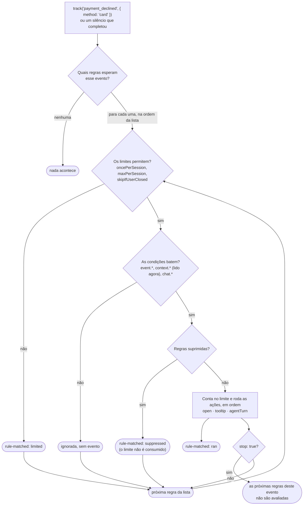

# Motor de regras

O motor de regras faz o chat **agir sozinho** no momento certo: abrir quando o comprador fica parado, mostrar uma dica no botão fechado ou fazer o agente **puxar conversa** quando o cartão é recusado.

A divisão de responsabilidades é simples:

- **A página informa o que aconteceu** (`track('payment_declined')`). Ela não decide se o chat abre, nem quando.
- **As regras decidem o que fazer** com cada acontecimento: são dados (JSON), sem código.
- **O chat executa** as ações e controla limites, pausas e concorrência.

## Sumário

1. [Conceitos](#conceitos)
2. [Primeiros passos](#primeiros-passos)
3. [Informando eventos: `track`](#track)
4. [Contexto da página: `getContext`](#contexto)
5. [Anatomia de uma regra](#anatomia)
   - [`when`: o gatilho](#when)
   - [`if`: as condições](#if)
   - [`then`: as ações](#then)
   - [`limit`, `stop` e `enabled`](#limit)
6. [Ações em detalhe](#acoes)
   - [`open`](#acao-open)
   - [`tooltip`](#acao-tooltip)
   - [`agentTurn`: o agente puxa conversa](#acao-agentturn)
7. [Pausando as regras: `suppressRules`](#suppress)
8. [Acompanhando: evento `rule-matched`](#monitorando)
9. [Exemplo completo: checkout](#exemplo-checkout)
10. [Comportamentos e casos de borda](#casos-de-borda)
11. [Referência](#referencia)

---

<a id="conceitos"></a>
## 1. Conceitos



- **As regras são avaliadas quando um evento acontece**, nunca em um loop. "4 minutos parado" também é um evento: o próprio motor dispara quando o tempo passa (veja [`silence`](#when)).
- **As regras ficam nas opções** do chat (`rules`) e passam a valer assim que as opções são definidas.

---

<a id="primeiros-passos"></a>
## 2. Primeiros passos

**Abrir o chat depois de 4 minutos sem atividade**, uma vez por visita:

```js
const tutorChat = document.getElementById('tutor-chat');

tutorChat.options = {
  // ...demais opções (productId, getToken etc.)
  rules: [
    {
      id: 'parado-4min',
      when: { silence: 240, of: ['activity'] },   // 240s sem o evento "activity"
      then: [{ action: 'open' }],
      limit: { oncePerSession: true },
    },
  ],
};

// a página informa o que conta como atividade
['input', 'click', 'keydown', 'scroll'].forEach(tipo =>
  document.addEventListener(tipo, () => tutorChat.track('activity'), { capture: true, passive: true }));
```

**Abrir o chat quando o cartão é recusado:**

```js
rules: [
  {
    id: 'cartao-recusado',
    when: { event: 'payment_declined' },
    if: [{ path: 'event.method', op: 'eq', value: 'card' }],
    then: [{ action: 'open' }],
  },
],

// no código do checkout, quando o gateway recusa
tutorChat.track('payment_declined', { method: 'card', reason: 'issuer' });
```

---

<a id="track"></a>
## 3. Informando eventos: `track`

```js
tutorChat.track(nome, dados?);
```

- **`nome`**: qualquer texto. O motor não interpreta o significado: `payment_declined`, `pix_generated` e `field_error` são combinados entre a página e as regras.
- **`dados`**: um objeto opcional, lido pelas condições como `event.*`.

```js
tutorChat.track('pix_generated', { expiresInMinutes: 30 });
tutorChat.track('field_error', { field: 'cpf' });
tutorChat.track('purchase_completed');
```

### O evento `activity`

`activity` é o que a página considera "o comprador está fazendo algo". É ele que alimenta as regras de [`silence`](#when). Duas características:

- **A página decide o que conta.** O exemplo acima conta digitação, cliques, teclas e rolagem.
- **Repetições em menos de 1 segundo são ignoradas.** `scroll` e `input` disparam dezenas de vezes por segundo, e o motor só considera uma por segundo. A página pode chamar `track('activity')` em todo evento, sem se preocupar com desempenho.

> **Por que `capture: true` e `passive: true`?** Com `capture`, o listener no `document` recebe o evento antes de qualquer elemento. Isso inclui a rolagem de áreas internas, que não sobe até o `document`, e cliques em que algum código chama `stopPropagation()`. Com `passive`, o navegador sabe que o listener não cancela a rolagem e não precisa esperá-lo, então a rolagem continua fluida.

### Eventos que o próprio chat informa

| Evento | Quando | `event.*` |
|---|---|---|
| `chat_opened` | o chat abre | `source`: `user` (botão), `host` (`open()` da página) ou `rule` (uma regra) |
| `chat_closed` | o chat fecha | `source`, idem |
| `message_sent` | o usuário envia uma mensagem | — |

### Eventos antes das regras carregarem

Eventos informados antes de o chat receber as opções ficam guardados (até 50) e são avaliados, em ordem, assim que as regras carregam.

---

<a id="contexto"></a>
## 4. Contexto da página: `getContext`

`getContext` diz **onde o usuário está e o que aconteceu** na página. O chat lê esse contexto em dois momentos:

1. **A cada mensagem e a cada [`agentTurn`](#acao-agentturn)**, enviando-o ao agente. O agente responde à situação real sem que o comprador precise explicá-la ("não deu, e agora?" já basta).
2. **Quando uma regra tem condições**, que leem `context.*`.

```js
tutorChat.options = {
  // ...
  getContext: () => ({
    'Etapa do checkout': 'na etapa de pagamento',
    'Forma de pagamento selecionada': 'cartão de crédito',
    'Total': 'R$ 197,00',
    'Parcelamento no cartão': 'até 12x de R$ 18,62',
    'Tentativas de pagamento': 'cartão recusado (recusado pelo banco emissor) às 14:32',
    'Segundos sem interação': 45,
  }),
};
```

- **Formato:** um objeto `descrição → valor` (como acima) ou uma lista `[{ description, value }]`. Pode ser síncrono ou devolver uma Promise.
- **Valores vazios são omitidos** (`null`, `undefined`, `''`). Números e booleanos viram texto.
- **Escreva as descrições como frases legíveis:** o agente lê exatamente esse texto.
- **Se `getContext` lançar um erro,** a mensagem é enviada sem contexto e o erro vai para o console.
- **Limites no servidor:** até 20 itens, 80 caracteres por descrição e 300 por valor. O excedente é cortado.

> ⚠️ **Nunca coloque dados pessoais ou de pagamento no contexto** (nome, e-mail, CPF, número do cartão). Informe o **estado**, como "CPF inválido", e não o CPF.

> ⚠️ O contexto passa pelo navegador, então o comprador pode alterá-lo. O agente o trata como **dado, não como instrução**. Use-o para orientar a conversa, nunca para decidir algo sensível (preço, elegibilidade a desconto).

---

<a id="anatomia"></a>
## 5. Anatomia de uma regra

```js
{
  id: 'cartao-recusado',                                   // obrigatório e único
  when: { event: 'payment_declined' },                     // o gatilho
  if: [{ path: 'event.method', op: 'eq', value: 'card' }], // condições (opcional)
  then: [{ action: 'agentTurn' }],                         // ações, em ordem
  limit: { maxPerSession: 2 },                             // limites (opcional)
  stop: true,                                              // interrompe as próximas regras do mesmo evento (opcional)
}
```

<a id="when"></a>
### 5.1 `when`: o gatilho

**Por evento:** a regra é avaliada sempre que o evento é informado.

```js
when: { event: 'payment_declined' }
```

**Por silêncio:** a regra dispara depois de N segundos **sem** nenhum dos eventos listados.

```js
when: { silence: 240, of: ['activity'] }                         // 4 minutos sem atividade
when: { silence: 600, of: ['activity', 'message_sent'] }         // 10 min sem atividade nem mensagem
when: { silence: 120, of: ['activity'], pauseWhenHidden: false } // conta mesmo com a aba escondida
```

Como o silêncio funciona:

- **O relógio começa** quando as regras carregam.
- **Qualquer evento de `of` zera a contagem.**
- **Ao disparar, a regra espera** um novo evento de `of` antes de contar de novo. Um silêncio longo dispara **uma vez**, e não a cada N segundos.
- **Com a aba escondida, a contagem pausa** (`pauseWhenHidden` é `true` por padrão). Quem está no app do banco pagando o Pix não está "parado".
- **Também pausa durante uma [supressão](#suppress)** e continua de onde parou depois.

<a id="if"></a>
### 5.2 `if`: as condições

Uma lista de condições, e **todas** precisam ser verdadeiras (E lógico). Sem `if`, a regra roda sempre que o gatilho acontece.

```js
if: [
  { path: 'context.Etapa do checkout', op: 'neq', value: 'compra concluída' },
  { path: 'chat.isOpen', op: 'eq', value: false },
]
```

**De onde vêm os valores (`path`):**

| Prefixo | O que é | Exemplo |
|---|---|---|
| `event.` | os dados do `track` que disparou a regra | `event.method`, `event.reason` |
| `context.` | o resultado de `getContext()` **no momento do evento**, pela descrição | `context.Etapa do checkout` |
| `chat.` | o estado do chat | `chat.isOpen`, `chat.isAnswering`, `chat.suppressed` |

> Em `context.`, tudo depois do primeiro ponto é a descrição inteira. `context.Versão 2.0 do plano` lê a descrição `Versão 2.0 do plano`, com ponto e tudo.

**Operadores:**

| `op` | Verdadeiro quando | Exemplo |
|---|---|---|
| `eq` | igual (comparado como texto) | `{ path: 'event.method', op: 'eq', value: 'card' }` |
| `neq` | diferente | `{ path: 'context.Etapa do checkout', op: 'neq', value: 'compra concluída' }` |
| `exists` | existe e não é vazio | `{ path: 'event.reason', op: 'exists' }` |
| `gt` | maior que (comparado como número) | `{ path: 'context.Cartões recusados', op: 'gt', value: 1 }` |
| `lt` | menor que | `{ path: 'context.Segundos sem interação', op: 'lt', value: 30 }` |

- **`eq` e `neq` comparam como texto,** então `true`, `'true'`, `2` e `'2'` se comparam como esperado.
- **`gt` e `lt` convertem para número.** Um valor do contexto como `'2'` funciona.

<a id="then"></a>
### 5.3 `then`: as ações

Uma lista de ações executadas **em ordem**. Se uma falhar, as seguintes continuam.

| Ação | O que faz |
|---|---|
| `{ action: 'open' }` | abre o chat |
| `{ action: 'tooltip', text: '...' }` | mostra um texto no balão do botão fechado |
| `{ action: 'agentTurn', ifOpen?: 'speak' \| 'skip' }` | o agente puxa conversa |

Detalhes de cada uma em [Ações em detalhe](#acoes).

<a id="limit"></a>
### 5.4 `limit`, `stop` e `enabled`

| Campo | Efeito |
|---|---|
| `limit.oncePerSession` | roda no máximo **1 vez por visita** |
| `limit.maxPerSession` | roda no máximo **N vezes por visita** |
| `limit.skipIfUserClosed` | não roda depois que o **usuário** fechou o chat (fechar pelo código não conta) |
| `stop: true` | depois que esta regra roda, as regras seguintes **do mesmo evento** não são avaliadas |
| `enabled: false` | desliga a regra, útil para manter a regra no código sem ativá-la |

**O que é "visita":** os limites ficam no `sessionStorage` do navegador, separados por produto e agente. **Valem para a aba inteira e sobrevivem a recarregamentos.** Um comprador que recarrega o checkout não vê o chat abrir de novo. Uma aba nova começa do zero.

**Ordem e `stop`:** as regras do mesmo evento são avaliadas na ordem da lista. Coloque as mais específicas primeiro e use `stop` para que uma regra genérica não rode também:

```js
rules: [
  { id: 'recusado-3x',  when: { event: 'payment_declined' }, if: [{ path: 'context.Cartões recusados', op: 'gt', value: 2 }],
    then: [{ action: 'agentTurn' }], stop: true },
  { id: 'recusado',     when: { event: 'payment_declined' }, then: [{ action: 'open' }] },
]
```

---

<a id="acoes"></a>
## 6. Ações em detalhe

<a id="acao-open"></a>
### 6.1 `open`

Abre o chat com a saudação normal. Se o chat já estiver aberto, não faz nada.

<a id="acao-tooltip"></a>
### 6.2 `tooltip`

Mostra um texto no balão ao lado do botão do chat fechado, sem abrir o chat:

```js
{ id: 'dica-pix', when: { event: 'pix_generated' },
  if: [{ path: 'chat.isOpen', op: 'eq', value: false }],
  then: [{ action: 'tooltip', text: 'Dúvidas sobre o Pix?' }],
  limit: { oncePerSession: true } }
```

- **O texto substitui o do tema** (`closed.tooltip.text`) e **some quando o chat abre**.
- **Para o balão aparecer só por regras,** deixe o texto do tema vazio. Sem texto, o balão não é exibido:
  ```js
  ThemeManager.setDefaultTheme({ closed: { tooltip: { text: '', position: 'left' } } });
  ```
- **Com o chat aberto,** o texto fica guardado e só aparece quando o chat fechar. Por isso o exemplo usa a condição `chat.isOpen = false`.

<a id="acao-agentturn"></a>
### 6.3 `agentTurn`: o agente puxa conversa

O agente envia uma mensagem **sem que o usuário tenha escrito nada**, baseada no contexto da página:

> *"Vi que o banco não autorizou o cartão — isso pode acontecer por limite ou segurança. Quer tentar pelo Pix, que é aprovado na hora?"*

```js
{ id: 'cartao-recusado', when: { event: 'payment_declined' },
  then: [{ action: 'agentTurn' }],                 // ifOpen: 'speak' é o padrão
  limit: { maxPerSession: 2 } }

{ id: 'parado-30s', when: { silence: 30, of: ['activity'] },
  then: [{ action: 'agentTurn', ifOpen: 'skip' }], // não interrompe quem já está no chat
  limit: { oncePerSession: true } }
```

**Como ele se comporta:**

| Situação | Comportamento |
|---|---|
| Chat **fechado** | O agente começa a responder em segundo plano e **o chat abre quando ele começa a falar**, já mostrando a mensagem. |
| Conversa nova, saudação **nunca vista** | A mensagem do agente **ocupa o lugar da saudação** e é a primeira da conversa, inclusive no histórico salvo. |
| Chat **aberto**, `ifOpen: 'speak'` (padrão) | A mensagem chega **depois** do que está na tela, por exemplo após a saudação. |
| Chat **aberto**, `ifOpen: 'skip'` | Nada acontece. |
| Usuário abre o chat enquanto o agente "pensa" | Aparecem os três pontinhos de digitação, depois a mensagem. A saudação não pisca. |
| Usuário tenta enviar mensagem durante o turno | O envio fica bloqueado até o agente terminar: **uma interação por vez**. |
| O agente está respondendo ao usuário | O turno é **descartado**, não enfileirado. O agente já conhece a situação pelo contexto na próxima mensagem. |
| Outro turno já em andamento | O novo é descartado. |
| O agente não produz texto (falha, sem resposta) | A saudação volta, e um chat fechado abre normalmente. |

**Requisitos:**

- **Contexto:** o agente responde a partir do [contexto da página](#contexto). Sem `getContext`, ele sabe apenas o nome do evento.
- **Instruções do agente:** o agente precisa de instruções para "puxar conversa". Hoje o **`checkout-agent`** está preparado para isso. Outros agentes recebem o pedido, mas não têm essas instruções.

---

<a id="suppress"></a>
## 7. Pausando as regras: `suppressRules`

Há momentos em que o chat **não deve** aparecer sozinho: pagamento sendo processado, desafio 3DS do banco, um modal da própria página.

```js
const liberar = tutorChat.suppressRules('processando-pagamento', { timeout: 30 });
try {
  await processarPagamento();
} finally {
  liberar();
}
```

| Durante a supressão | Comportamento |
|---|---|
| `track()` | os eventos continuam sendo recebidos |
| Regras por evento | **descartadas**: não rodam nem depois, porque "cartão recusado" mostrado minutos mais tarde já não faz sentido |
| Regras de silêncio | **pausadas**: continuam de onde pararam ao liberar |
| Limites | **não são consumidos**: uma regra descartada pode rodar depois |
| Usuário abrindo o chat | **sempre funciona**: a supressão só afeta o que é automático |
| Resposta do agente em andamento | continua normalmente |

- **Várias supressões ao mesmo tempo:** cada chamada devolve sua própria função `liberar`. As regras só voltam quando **todas** forem liberadas. O modal da página pode liberar a dele sem reativar as regras enquanto o 3DS ainda está ativo.
- **`timeout` (segundos):** libera sozinho, para que um erro no código da página não deixe as regras desligadas para sempre.
- **`tutorChat.rulesSuppressed`:** `true` enquanto houver alguma supressão ativa.

---

<a id="monitorando"></a>
## 8. Acompanhando: evento `rule-matched`

Quando o gatilho de uma regra acontece, o chat dispara um evento `rule-matched` contando o que aconteceu com ela:

```js
document.addEventListener('rule-matched', (e) => {
  const { ruleId, event, status, reasons } = e.detail;
  analytics.track('chat_rule', { ruleId, event, status, reasons: reasons.join(',') });
});
```

| `status` | Significado | `reasons` |
|---|---|---|
| `ran` | passou nas condições e as ações rodaram | `[]` |
| `suppressed` | passou nas condições, mas foi descartada por uma supressão ativa | os motivos das supressões, ex.: `['processando-pagamento']` |
| `limited` | bloqueada por um limite. Os limites são verificados **antes** das condições, então isso aparece mesmo que as condições não fossem bater | os limites atingidos, ex.: `['maxPerSession 2']`, `['oncePerSession']`, `['skipIfUserClosed']` |

> Uma regra dentro dos limites cujas **condições** não batem não gera evento. Elas seriam avaliadas a cada `activity`, e o volume ficaria grande demais.

### Testando: zerando os limites

Como os limites sobrevivem a recarregamentos, testar a mesma regra várias vezes exige zerá-los:

```js
tutorChat.resetRuleLimits();   // esquece quantas vezes cada regra rodou e se o usuário fechou o chat
```

Também funciona abrir a página em uma aba nova, ou rodar `sessionStorage.clear()` no console.

---

<a id="exemplo-checkout"></a>
## 9. Exemplo completo: checkout

Um checkout que informa os acontecimentos e deixa as regras cuidarem do chat:

```js
const tutorChat = document.getElementById('tutor-chat');

tutorChat.options = {
  productId: '…',
  agentName: 'checkout-agent',
  isExternalProductId: false,
  getToken: obterToken,

  getContext: () => ({
    'Etapa do checkout': checkout.etapaLegivel(),          // "na etapa de pagamento", "compra concluída"…
    'Forma de pagamento selecionada': checkout.metodo(),   // "cartão de crédito", "Pix", "boleto"
    'Total': checkout.totalFormatado(),
    'Tentativas de pagamento': checkout.resumoTentativas(),
    'Cartões recusados': checkout.cartoesRecusados() || null,
    'Pix': checkout.pix ? `gerado, expira às ${checkout.pix.expiraAs}, ainda não pago` : null,
  }),

  rules: [
    {
      // cartão recusado: o agente oferece o Pix, mesmo com o chat aberto
      id: 'cartao-recusado',
      when: { event: 'payment_declined' },
      if: [{ path: 'event.method', op: 'eq', value: 'card' }],
      then: [{ action: 'agentTurn' }],
      limit: { maxPerSession: 2 },
      stop: true,
    },
    {
      // Pix gerado com o chat fechado: só uma dica no botão
      id: 'dica-pix',
      when: { event: 'pix_generated' },
      if: [{ path: 'chat.isOpen', op: 'eq', value: false }],
      then: [{ action: 'tooltip', text: 'Dúvidas sobre o Pix?' }],
      limit: { oncePerSession: true },
    },
    {
      // 15s parado: uma dica discreta
      id: 'parado-dica',
      when: { silence: 15, of: ['activity'] },
      if: [
        { path: 'context.Etapa do checkout', op: 'neq', value: 'compra concluída' },
        { path: 'chat.isOpen', op: 'eq', value: false },
      ],
      then: [{ action: 'tooltip', text: 'Posso ajudar?' }],
      limit: { oncePerSession: true, skipIfUserClosed: true },
    },
    {
      // 30s parado: o agente puxa conversa, mas não interrompe quem já está no chat
      id: 'parado-conversa',
      when: { silence: 30, of: ['activity'] },
      if: [{ path: 'context.Etapa do checkout', op: 'neq', value: 'compra concluída' }],
      then: [{ action: 'agentTurn', ifOpen: 'skip' }],
      limit: { oncePerSession: true, skipIfUserClosed: true },
    },
  ],
};

// atividade
['input', 'click', 'keydown', 'scroll'].forEach(tipo =>
  document.addEventListener(tipo, () => tutorChat.track('activity'), { capture: true, passive: true }));

// pagamento
async function pagar() {
  const liberar = tutorChat.suppressRules('processando-pagamento', { timeout: 30 });
  try {
    const r = await gateway.pagar();
    if (r.aprovado) tutorChat.track('purchase_completed');
    else tutorChat.track('payment_declined', { method: checkout.metodo(), reason: r.motivo });
  } finally {
    liberar();
  }
}

checkout.onPixGerado(() => tutorChat.track('pix_generated'));
```

---

<a id="casos-de-borda"></a>
## 10. Comportamentos e casos de borda

| Situação | O que acontece |
|---|---|
| Recarreguei a página e a regra não rodou mais | O limite foi atingido nesta aba (os limites sobrevivem a recarregamentos). Use `resetRuleLimits()` ou uma aba nova. O evento `rule-matched` com `status: 'limited'` mostra qual limite. |
| `agentTurn` com `ifOpen: 'skip'` e chat aberto | Nada acontece, **mas a regra conta como executada** e consome o limite. Para não consumir, use a condição `chat.isOpen = false` em vez de `ifOpen: 'skip'`. |
| Duas regras de silêncio (15s dica, 30s conversa) | Cada uma tem o próprio relógio. A atividade zera as duas. |
| Silêncio disparou e o usuário continua parado | Não dispara de novo até uma nova atividade. |
| Aba em segundo plano | Os silêncios pausam (a menos que `pauseWhenHidden: false`). |
| `sessionStorage` bloqueado (modo privado restrito) | Os limites ficam só em memória e valem até recarregar a página. |
| Regra com `id` repetido na lista | Vale a última. |
| Erro em uma ação | Vai para o console. As outras ações da regra e as outras regras continuam. |
| `getContext` lança erro durante uma condição | As condições recebem um contexto vazio e as que dependem dele falham. |
| Evento informado antes de `options` | Fica na fila (até 50) e é avaliado quando as regras carregam. |
| `track` com um nome que nenhuma regra usa | Nada acontece (custo quase zero). |
| Usuário fechou o chat e uma regra tem `skipIfUserClosed` | A regra não roda mais nesta visita. Fechar pelo código (`close()`) não conta. |

---

<a id="referencia"></a>
## 11. Referência

### Opções

```ts
rules?: Rule[];
getContext?: () => PageContext | Promise<PageContext>;

type PageContext =
  | Record<string, string | number | boolean | null | undefined>
  | { description: string; value: string }[];

type Rule = {
  id: string;
  enabled?: boolean;
  when:
    | { event: string }
    | { silence: number; of: string[]; pauseWhenHidden?: boolean };
  if?: { path: string; op: 'eq' | 'neq' | 'exists' | 'gt' | 'lt'; value?: unknown }[];
  then: (
    | { action: 'open' }
    | { action: 'tooltip'; text: string }
    | { action: 'agentTurn'; ifOpen?: 'speak' | 'skip' }
  )[];
  limit?: { oncePerSession?: boolean; maxPerSession?: number; skipIfUserClosed?: boolean };
  stop?: boolean;
};
```

### Métodos e propriedades do elemento

| API | Descrição |
|---|---|
| `track(nome, dados?)` | informa um acontecimento da página |
| `suppressRules(motivo, { timeout? })` | pausa as regras e devolve a função que libera |
| `rulesSuppressed` | `true` enquanto houver supressão ativa |
| `resetRuleLimits()` | zera os limites desta visita (para testes) |
| `open(source?)` / `close(source?)` | abrem e fecham o chat. `source` é `'host'` por padrão |

### Eventos do elemento

| Evento | `detail` |
|---|---|
| `rule-matched` | `{ ruleId, event, status: 'ran' \| 'suppressed' \| 'limited', reasons }` |

Veja também: [Ferramentas do agente](documentacao-ferramentas.md), para mostrar cupons e outros resultados das ferramentas no chat.
